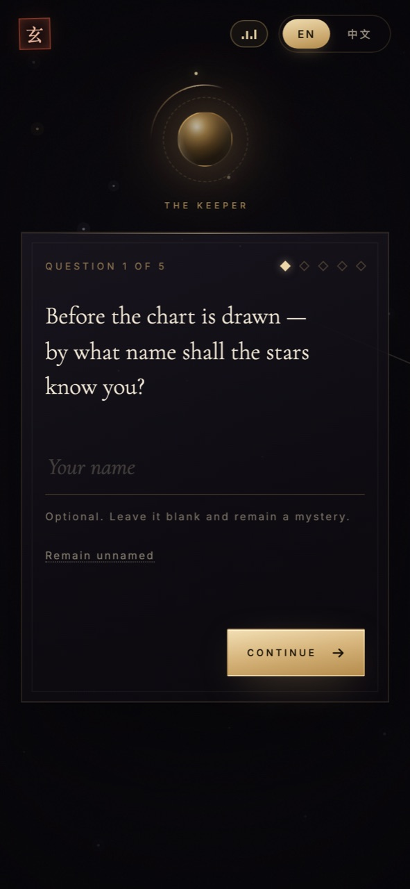
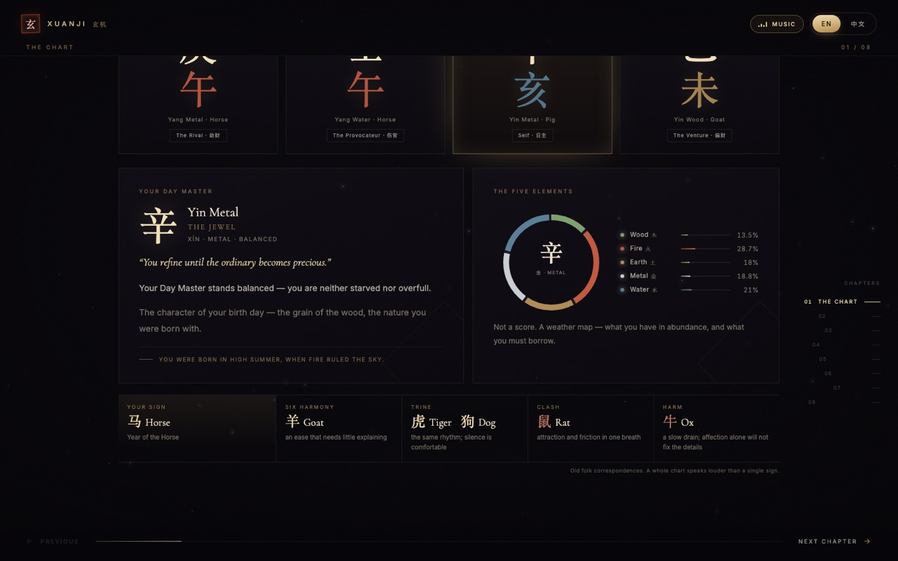
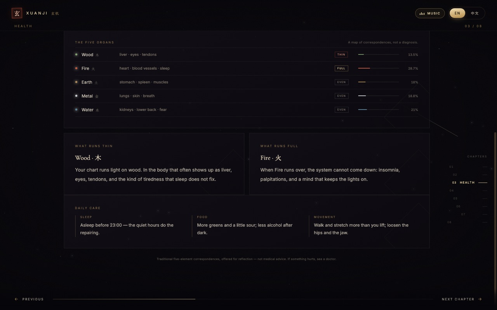
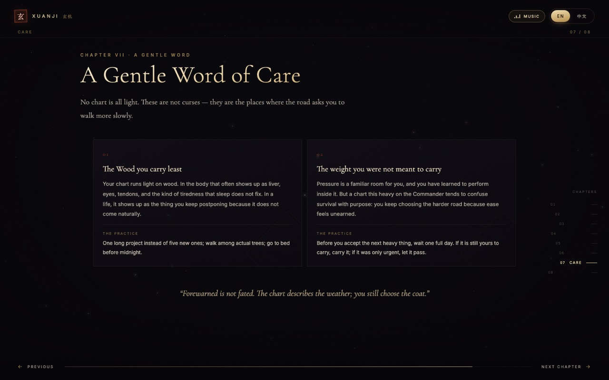
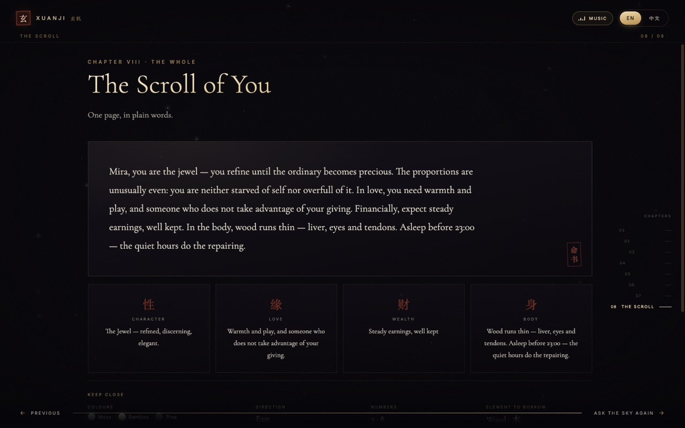

# 玄机 XUANJI · 东方命理测评 — 产品与界面设计方案

> 面向西方客户的东方命理测算 Web 应用。中文 / English 实时切换，对话式采集生辰，八章命书式输出。
> 交付物：`index.html`（单文件、零依赖、可直接双击打开）。

---

## 一、定位与策略

**一句话定位**：不是"算命网站"，而是一份**为你一人写就的东方命书**——用现代、克制、有审美的方式，把四柱八字翻译成西方用户能理解的语言。

| 维度 | 选择 | 原因 |
|---|---|---|
| 气质 | 神秘、安静、克制、收藏级 | 西方用户对"东方玄学"的期待是氛围与仪式感，而非廉价占卜感 |
| 语言 | 英文优先，中文可切换 | 目标客户为西方用户；中文切换满足华人用户与演示场景 |
| 门槛 | 5 个问题、约 4 分钟 | 低于 5 分钟可完成，避免长表单流失 |
| 内容 | 性格 → 婚恋 → 财富 → 流年 → 委婉提醒 → 总览 | 先"被看见"，再"被提醒"，最后"被总结"，符合心理接受顺序 |
| 边界 | 观照而非预言 | 所有断语用"倾向 / 可能 / 老话说"，并附免责声明 |

**核心体验弧线**：
黑暗中的一点光 → 守卷人发问 → 命盘被"起"出来 → 八章逐页展开 → 一枚印章落下 → 把一句话带走。

---

## 二、信息架构与流程

```
① 引导页（Intro）
   └─ 星尘、旋转八卦环、发光命珠、"开始测算"
② 对话式采集（Dialogue）—— 守卷人逐题发问，打字机呈现，一次只问一件事
   Q1 姓名（选填，可"暂不留名"）
   Q2 出生日期
   Q3 出生时间
   Q4 性别（女 / 男）
   Q5 出生地（城市，自动匹配时区）
   → 复述确认页（可逐项"修改"）
③ 起盘动画（Casting）—— 十天干环绕、四句仪式文案、进度线
④ 命书输出（Reading）—— 8 章，左右翻页 / 圆点跳转 / 键盘 / 滑动
   Ⅰ 天盘  Ⅱ 本性  Ⅲ 身体  Ⅳ 情缘  Ⅴ 财禄  Ⅵ 流年  Ⅶ 慎言  Ⅷ 总览
⑤ 收尾 —— 重新测算 / 导出 PDF
```

**为什么把"确认页"单独做一步**：出生时间直接决定时柱与晚年/子女宫，是命理里最容易被用户记错的一项。复述 + 逐项修改，既降低错误率，也强化"仪式被认真对待"的感受。

---

## 三、视觉系统

### 色彩
| Token | 值 | 用途 |
|---|---|---|
| Ink | `#07060a` | 背景，带紫褐微光的黑，不是纯黑 |
| Gold | `#c8a56a` → `#ecd6a8` | 主色，标题渐变、细线、星尘 |
| Cinnabar | `#a8442f` | 印章、桃花、警示页的"朱砂"点缀 |
| Paper | `#eee4d2` | 正文亮色 |
| Muted | `#918879` | 辅助文字 |
| 五行色 | 木 `#7fa06f` / 火 `#c05a41` / 土 `#b08d57` / 金 `#c9cdd4` / 水 `#5a7f96` | 仅用于数据可视化，饱和度压低以融入夜色 |

### 字体
- 英文标题：**Cormorant Garamond**（300/400，高对比、古典、有占卜书的味道）
- 中文：**Songti SC / Noto Serif SC**（宋体，端庄；不回退到黑体）
- 正文与 UI：**Inter**（小字号、长段落可读性）
- 标签：10px、字距 0.28–0.4em、全大写——制造"铭刻"感

### 材质与光
- 全屏 Canvas 星场（约 200 颗，视差 + 闪烁 + 偶发流星）
- SVG feTurbulence 胶片颗粒（3.5% 透明）
- 径向渐晕，四角压暗
- 金色非实色：一律用 175° 渐变 + `background-clip:text`，避免"土豪金"
- 面板是"半透明黑玻璃"：`backdrop-filter: blur(20px)` + 1px 金线 + 内嵌细线

### 动效原则
| 场景 | 时长 | 缓动 |
|---|---|---|
| 页面/章节切换 | 0.9s | `cubic-bezier(.16,1,.3,1)` |
| 元素入场 | 0.8–0.95s，逐项延迟 60–80ms | 同上，带 3px 模糊消散 |
| 命珠呼吸 | 8s 循环 | ease-in-out |
| 八卦环旋转 | 16s / 45s / 150s（首屏） | linear，多层反向 |
| 打字机 | 16ms/字，标点处 ×5 停顿 | — |
| 印章落下 | 1.2s | 从 1.6 倍缩放 + 模糊砸下 |

所有动画都遵守 `prefers-reduced-motion`。

### 声音
页面内置客户提供的 `assets/theme.mp3`（33 秒）。构建时以 base64 嵌入 HTML，运行时用 Web Audio 解码成 AudioBuffer 做**采样级无缝循环**；主音量 0.14（相对原始母带约 −17 dB），淡入 2.8 秒，顶栏提供静音开关。受浏览器自动播放策略限制，音乐在**首次点击后**启动，并跨章节持续播放。

移动端（390 × 844）将守卷人与对话框改为上下结构，隐藏右侧章目，保留底部翻页与左右滑动：



---

## 四、逐屏设计

### ① 引导页


- **构成**：命珠（发光球体）+ 三层旋转环 + 八卦符号环 + 漂浮光尘 + 标题 + 副标题 + 主按钮 + 双行 meta
- **文案**：*The Eastern Oracle* / 东方命理；"Four pillars. Eight characters. One life, waiting to be read."
- **动效**：光点落下 → 命珠点亮 → 标题逐行浮起 → 按钮出现
- **目的**：3 秒内建立"这是一个值得停留的仪式"，而不是一个表单

### ② 对话页
- **左侧**：缩小的命珠（"守卷人"），说话时脉冲发光
- **右侧**：玻璃卡 + 问题 + 输入 + 进度菱形 + 操作
- **一次只问一件事**：姓名 → 日期 → 时间 → 性别 → 出生地
- 问题文案带叙事，不是标签：
  - "Now the day the world first felt your weight. When were you born?"
  - "And at what hour? The old readers kept time by incense and shadow."
- **细节**：
  - 姓名可跳过（Remain unnamed），降低第一题流失
  - 性别用两张带 ♀ / ♂ 的卡片，而非 radio
  - 城市输入自动匹配 IANA 时区，并可手动修正（时柱依赖真太阳时/经度）
  - 进度用 5 枚菱形，已完成实心、当前发光
  - 点击问题文字可跳过打字机动画
  - `Enter` 继续，`Back` 保留已填内容

### ③ 起盘动画
- 命珠外环绕**十天干**（甲乙丙丁…）缓慢旋转
- 四句仪式文案依次点亮：校准十天干 / 称量五行 / 推转十二地支 / 落墨四柱
- 底部一线金光进度
- 约 4.5s，足够"起盘"的仪式感，又不至于让用户等得不耐烦

### ④ 输出：八章命书

每章都有：`CHAPTER · 章节名` 眉标 → 大标题 → 一句导语 → 内容模块 → 上一页/下一页。
右侧圆点导航（悬停显章节名），底部进度线，移动端隐藏侧栏、保留底部导航与滑动翻页。

#### Ⅰ 天盘 — The Chart of Heaven
**目的**：让用户第一眼"看见自己的命盘"，建立专业感。



- 四柱卡（年/月/日/时）：天干大字 + 地支大字（按五行着色）+ 阴阳五行·生肖 + 十神标签；日柱金框高亮，标"日主 / Self"
- 日主卡：日主字 + 名称（如 Yin Metal · The Jewel）+ 拼音 + 旺弱 + 一句"本质" + 旺弱解读 + 出生节气
- 五行环：SVG 环形图，五段按百分比绘制并逐段生长；中心是日主字；右侧图例带百分比条
- 生肖合冲条：天盘页底部（日主与五行之后）增加"生肖 · 合与冲"横条——你的生肖（如 马 Horse）、六合（羊 Goat）、三合（虎 Tiger / 狗 Dog）、相冲（鼠 Rat）、相害（牛 Ox），每格一句提示（如"吸引与摩擦，在同一口气里"），并注明"民间说法，一张完整的命盘比单个生肖更有分量"
- 动效：四柱逐张浮起 → 环比生长 → 生肖条淡入

#### Ⅱ 本性 — The Shape of You
**目的**：回答"我是谁"，这是用户最在意、也最愿意分享的一页。

- 顶部：性格原型（The Jewel 珠玉）+ 日主 + 拼音 + 一句本质引语
- 五枚性格标签（来自日主 + 旺神）
- 三块内容：
  1. **底色**：日主性格正文 + 旺弱补充
  2. **气候**：最旺五行 + 最弱五行，各一段（旺处是天赋也是风险，弱处是功课）
  3. **在人之间**：最旺十神带来的社交/做事风格
- 设计意图：不贴星座式标签，而是"天赋—阴影"成对出现

#### Ⅲ 身体 — The Body You Live In
**目的**：在"性格"之后回答"我的身体需要注意什么"，承接前文的五行强弱。

- **体质**：日主旺弱 → 三种体质模型（底子厚 / 中和 / 精密型），再给出出生节气对体质的影响
- **五行与脏腑**：五行对应脏腑（木—肝目筋、火—心血脉、土—胃脾肌肉、金—肺皮肤、水—肾腰），每行带百分比条与"不足 / 平和 / 偏旺"状态
- **留意之处**：最弱五行的身体表现 + 最旺五行的过载表现，两张卡
- **日常养护**：睡眠 / 饮食 / 运动三条，取自"宜补五行"
- 页脚明确："这是传统五行对应，不是诊断；身体不适请就医"



#### Ⅳ 情缘 — Matters of the Heart
**目的**：把"夫妻宫"翻译成现代关系语言。

- 四张卡：你如何去爱 / 你需要什么 / 摩擦生于何处 / 与你相配的人
- 依据：日支（夫妻宫）+ 伴侣星（女命官杀 / 男命财星）强弱 + 桃花
- 底部横幅：伴侣星状态（明亮/中和/偏静）的完整解读
- 语气：不做"克夫克妻"式断言，一律用"你需要 / 容易 / 功课是"

#### Ⅴ 财禄 — The Flow of Abundance
**目的**：回应用户对"钱"的焦虑，但拒绝成功学。

- 顶部宽卡：用财气质（财星强弱 × 日主旺弱 → 四种模型）+ 朱砂"财"印
- 左：财从何处来（一句话结论）+ 适合的行当标签（来自用神五行）
- 右：何处易漏（比劫 / 食伤 / 日主弱 / 常态消耗 四类）
- 底部：一句克制的提醒——"命盘只显示倾向，不是账户余额"

#### Ⅵ 流年 — The Turning of Cycles
**目的**：给出"时间感"，让命书不止于性格。

- 十年大运时间轴：8 步，显示年龄区间 + 干支 + 拼音，当前大运高亮并标 NOW
- 当前大运解读：该运十神带来的十年主题（含风险）
- 未来四年：年份 + 干支 + 年龄 + 一句年度主题；与日支相冲的年份用朱砂色提示
- 起运年龄标注（3 天折 1 年的传统算法）

#### Ⅶ 慎言 — A Gentle Word of Care
**目的**：满足"提示灾祸/不足"的需求，同时不制造恐惧。这是整套产品最需要分寸的一页。



结构：**每张卡 = 隐忧（The shadow）+ 对治（The practice）**
- 选题优先级（自动从命盘挑选 2–3 条）：
  1. 日支与年/月/时相冲 → 根基/事业/家庭/野心与休息的拉扯
  2. 最弱五行 → 身体与性格上的"补课"，附具体做法
  3. 七杀过重 → 把"撑住"误当"意义"
  4. 伤官过重 → 舌头上的锋刃
  5. 比劫过重 → 漏水的桶
  6. 日主弱 + 官杀重 → 活在别人的期待里
- 收尾金句："Forewarned is not fated. The chart describes the weather; you still choose the coat."
- **措辞三原则**：不出现"死/灾/破财/离婚"等判决词；每条隐忧必须配一个可执行动作；把问题归因于"倾向/天气"，不归因于用户

#### Ⅷ 总览 — The Scroll of You
**目的**：给用户一张可以截图、可以带走的"命书首页"。



- 总述段：姓名 + 性格原型 + 日主旺弱 + 情感需要 + 财务一句话 + 身体一句（最弱五行、对应脏腑与一条养护）
- 四句断语：为人 / 婚恋 / 财富 / 身体（各配朱砂字"性 / 缘 / 财 / 身"）。身体一句取"最弱五行 + 对应脏腑 + 一条日常养护"，把前面身体章收进总览
- 随身之物：幸运色（3 个色卡）、方位、数字、宜补五行
- 一句可带走的话（每个日主一句箴言，如"允许某件事未完成，也依然好看"）
- "命书"朱砂印章落下
- 收尾："The chart ends. The life does not." / "盘到此为止，人生没有。"
- 操作：重新测算 / 导出 PDF

---

## 五、测算逻辑（真实可算，非随机文案）

`src/bazi.js` 实现了完整的四柱推演：

1. **太阳视黄经**：Meeus 低精度算法（精度约 0.01°，约 ±15 分钟），用于判断节气
2. **年柱**：以立春（黄经 315°）为界，非农历正月初一
3. **月柱**：黄经每 30° 一节，五虎遁定月干
4. **日柱**：儒略日数 + 甲子锚点（1949-10-01 甲子日校准）
5. **时柱**：五鼠遁；23:00 后按次日日柱起子时（可在代码中调整）
6. **大运**：阳年男/阴年女顺排，反之逆排；起运 = 距最近节气的天数 ÷ 3（3 天折 1 年）
7. **五行力量**：天干 + 地支藏干加权，月支得令加权，归一化为百分比
8. **十神**：日主与其余天干/藏干的生克与阴阳关系
9. **旺弱**：日主 + 印星占比；**用神**：旺则取泄耗克中最少者，弱则取生扶中最少者（平衡启发式）
10. **桃花 / 六冲**：日支与其余地支比对

> 说明：用神与旺弱为**产品级启发式**，并非职业命理师的完整格局判断。若要做付费深度报告，建议在此之上加入调候、通关、格局、神煞与真太阳时校正。

**时区**：通过 IANA 时区 + `Intl.DateTimeFormat` 计算历史偏移，自动处理夏令时；城市库覆盖欧美、亚太、拉美、非洲约 90 个主要城市，找不到时回退到浏览器时区并可手动选择。

**随机性**：内容库按命盘参数组合，不含随机数——同一份出生信息每次得到同一份命书，这对"可信度"至关重要。

---

## 六、双语策略

- 所有文案以 `{ en, zh }` 成对存储；`t()` 取当前语言
- 切换语言**不刷新、不丢状态**：对话页保留输入，输出页保留章节与滚动位置
- 排版随语言变化：中文用宋体、加大行高与字距；英文用 Cormorant / Inter
- 视觉里保留汉字作为"纹样"（四柱、印章、章节字），即使英文模式也不翻译——这正是东方感的来源
- 数字、日期、时辰按语言本地化（`June 15, 1990` ↔ `1990年6月15日`；`2:30 pm` ↔ `14:30 · 未时`）

---

## 七、技术与文件结构

```
xuanji/
├── index.html               ← 单文件成品（内联 CSS/JS/音频，可直接打开）
├── assets/theme.mp3         ← 背景音乐源文件（构建时嵌入）
├── build.mjs                ← 将 src/ 打包进模板
├── src/
│   ├── index.template.html  ← 页面骨架
│   ├── styles.css           ← 视觉系统 + 响应式 + 打印样式
│   ├── bazi.js              ← 天文/历法/四柱/五行/大运引擎
│   ├── music.js             ← 背景音乐：解码、无缝循环、淡入淡出
│   ├── content.js           ← 双语内容库与解读生成
│   └── app.js               ← 屏幕状态机、对话、渲染、动效
├── tools/                   ← 无头 Chrome 预览与端到端测试
└── shots/                   ← 预览截图 / 示例 PDF
```

- 零运行时依赖；仅 Google Fonts 一个外部请求（离线时自动回退系统字体）
- 用户出生数据**只存在于浏览器内存**，不上传、不落盘
- 构建：`node build.mjs`
- 测试：`node tools/test.mjs`（40 项端到端断言，含校验、回退、双语切换、翻页、重开、打印样式）
- 打印：`window.print()` 已适配浅色纸张样式，八章分页输出（示例：`shots/reading.pdf`）

---

## 八、边界、合规与可扩展

**必须保留的边界**
- 首屏与页脚："For reflection, not prediction / 仅供观照，不作定论"
- 不做医疗、法律、投资建议；不预测死亡、疾病诊断、具体金额
- 西方市场需注意：GDPR（本应用不采集数据，天然合规）、不得使用"guaranteed"类表述、建议加入 18+ 提示

**可扩展方向**
1. **AI 个性化长文**：把命盘 JSON 作为 prompt 上下文，生成 1500 字深度报告（当前为规则文案，优点是零成本、稳定、可离线）
2. **合盘 / 流年 12 个月**：双人输入，输出相处模式与年度月历
3. **付费与留存**：免费 3 章 → 解锁全 8 章；邮箱保存命书；分享卡片（Canvas 生成 9:16 图）
4. **真太阳时**：根据出生地经度做时差校正，提升时柱精度
5. **多语言**：西/法/德/日，内容库结构已支持
6. **换曲**：替换 `assets/theme.mp3` 后重新执行 `node build.mjs` 即可；若想调整音量，改 `src/music.js` 的 `VOLUME`（当前 0.14）

---

## 九、为什么这样设计（给决策者的三句话）

1. **先仪式，后信息**：用户愿意为"被认真对待的感觉"多等 4 分钟，但不愿为一张表单多填 10 秒。
2. **先看见，后提醒**：性格与情缘页先让用户点头，慎言页的提醒才会被当作善意，而不是冒犯。
3. **把"命"做成审美**：真正让西方用户截图分享的，不是"你会发财"，而是"这句话说中了我"和"这张图真好看"。
