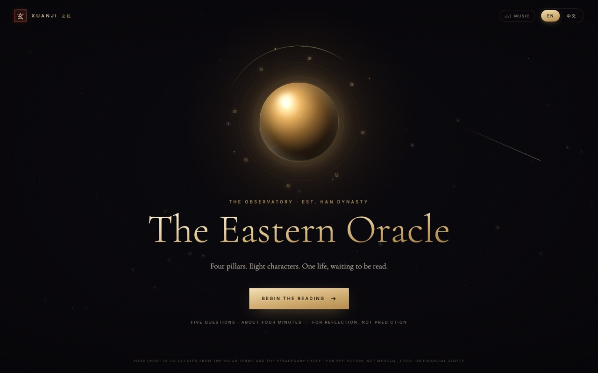

# XUANJI · 玄机 — The Eastern Oracle

A bilingual (English / 中文) Eastern astrology reading for Western audiences.
Four pillars, five elements, eight chapters — built as a single, dependency-free HTML file.



## Run it

Open `index.html` in a browser. That's it — no server, no build step, no dependencies.

> Fonts are loaded from Google Fonts when online; offline it falls back to Georgia / Songti.

## What's inside

- **Guided ritual** — five conversational questions with a typewriter guide, a confirmation step, and a chart-casting animation.
- **Real chart engine** — solar-term year/month boundaries, sexagenary day cycle, hidden stems, ten gods, five-element weighting, luck cycles.
- **Zodiac affinities** — your sign plus six-harmony, trine, clash and harm companions, on the chart page.
- **Eight reading chapters** — the chart, the self, the body, love, wealth, cycles, a gentle word of care, and a one-page scroll. The closing scroll carries four verdicts: character, love, wealth and body.
- **Background music** — the supplied theme is embedded at build time, decoded with Web Audio and looped sample-accurately at 14% volume. Starts on the first click; mute control in the top bar.
- **Live language switch** — every string is paired; switching rewrites the current screen without losing input, page, or scroll position.
- **Print / PDF** — a light-paper stylesheet turns the eight chapters into a printable booklet.

## Build

Edit files in `src/`, then:

```bash
node build.mjs        # bundles src/ → index.html
```

| File | Role |
|---|---|
| `src/index.template.html` | page skeleton |
| `src/styles.css` | visual system, responsive, print |
| `src/bazi.js` | astronomy, calendar, four pillars, luck cycles |
| `src/music.js` | soundtrack decode, seamless loop, fade in/out |
| `assets/theme.mp3` | supplied theme, embedded at build time |
| `src/content.js` | bilingual copy + interpretation builders |
| `src/app.js` | screen state machine, dialogue, rendering |

## Test / preview

The dev scripts drive headless Chrome over CDP:

```bash
# start Chrome once
"/Applications/Google Chrome.app/Contents/MacOS/Google Chrome" \
  --headless=new --no-sandbox --disable-gpu --remote-debugging-port=9333 \
  --user-data-dir=/tmp/cx-cdp about:blank &

node tools/test.mjs      # 40 end-to-end assertions
node tools/preview.mjs   # screenshots the whole flow into shots/ (PNG)
node tools/print.mjs     # exports shots/reading.pdf
node tools/mobile.mjs    # mobile intro / dialogue
```

## Customising

- **Brand / copy** — `UI` and the content tables in `src/content.js`.
- **Palette & type** — CSS variables at the top of `src/styles.css`.
- **Chart conventions** — `buildChart()` in `src/bazi.js`: day boundary at 23:00, luck-cycle direction, element weights, useful-element heuristic.
- **Cities / time zones** — `CITIES` in `src/app.js`.
- **Soundtrack** — replace `assets/theme.mp3` and run `node build.mjs`. Volume lives in `src/music.js` (`VOLUME = 0.14`). The track is embedded as base64, so `index.html` stays self-contained (about 1.2 MB).

## A note on scope

This is a reflective, entertainment-oriented reading — not medical, legal, or financial advice.
Birth data never leaves the browser; there is no analytics and no backend.
See `DESIGN.md` for the full product and interaction rationale.
